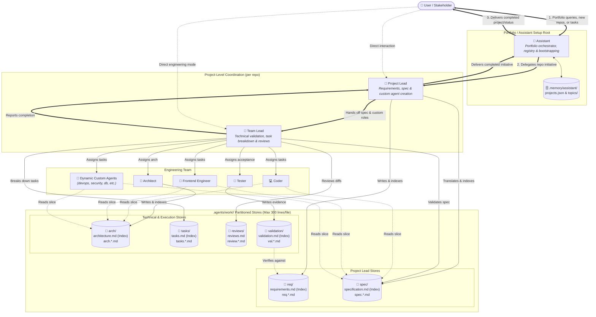

# agent-skills

Repository for storing and sharing reusable custom agents and skills I use periodically.

This repo uses the open [Agent Skills](https://agentskills.io/) format so the skills here stay **AI toolchain agnostic**. The canonical location for skills is `.agents/skills/`. Custom agents live under `.agents/agents/` as markdown files with YAML frontmatter.

## Repository intent

- Keep reusable skills in a portable, shareable format.
- Prefer the standard `SKILL.md`-based Agent Skills structure over tool-specific skill formats.
- Keep custom agents next to skills so this repository is the source of truth for both.
- Use this repository as the source of truth for skills and agents that can be consumed by compatible clients.

## Skill layout

Each skill should live under `.agents/skills/<skill-name>/` and follow the standard structure:

```text
.agents/
└── skills/
    └── <skill-name>/
        ├── SKILL.md
        ├── scripts/
        ├── references/
        └── assets/
```

Notes:

- `SKILL.md` is required.
- `scripts/`, `references/`, and `assets/` are optional.
- Keep instructions portable and avoid coupling a skill to one AI product unless that dependency is explicit and necessary.

## Agent layout

Each agent is a single markdown file:

```text
.agents/
└── agents/
    └── <agent-name>.md
```

Notes:

- YAML frontmatter must include `name` and `description`.
- The markdown body is the agent's system prompt.
- Keep the prompt focused on behavior the default agent does not already have.

### Cross-Harness Support (Antigravity, Grok, Claude, GitHub Copilot)

This repository serves as the single source of truth for custom agents designed to run across multiple AI harnesses:
- **Antigravity**: Discovers custom agents directly from `.agents/agents/` in the project root, or globally from `~/.agents/agents/` and `~/.gemini/config/agents/`.
- **Grok (`grok-build`)**: Discovers project agents from `.grok/agents/` and user agents from `~/.grok/agents/`.
- **Claude (Claude Code)**: Discovers project subagents from `.claude/agents/` and user subagents from `~/.claude/agents/`.
- **GitHub Copilot**: Discovers project custom agents from `.github/agents/`.

All custom agents are mirrored across `.agents/agents/`, `.grok/agents/`, `.claude/agents/`, and `.github/agents/` so they are immediately accessible in whichever harness or tool you run.

#### Universal Cross-Harness Capability Rule

**All agents, skills, tools, and orchestration workflows in this repository must always be implemented and verified for all supported harnesses (Antigravity, Grok, Claude Code, and GitHub Copilot), never coupled to a single platform.**

- **No Single-Runtime Assumptions**: Never write prompts or skills that assume a single runner's proprietary toolset (e.g., assuming `spawn_subagent` exists without specifying `invoke_subagent` for Antigravity and `Task` for Claude Code).
- **Explicit Tool & Invocation Mapping**: Any tool-dependent capability (subagent spawning, task handoff, messaging, memory manipulation) must document the exact tool name, argument format, and lifecycle semantics for each supported harness.
- **Strict Mirroring**: Agent files across `.agents/agents/`, `.grok/agents/`, `.claude/agents/`, and `.github/agents/` must remain synchronized and identical.
- **Universal Frontmatter Schema**: Frontmatters must combine declarations for all platforms:
  - **Antigravity (`agy`)**: `mainAgent: true`, `subagent: true`, and explicit `tools:` list.
  - **Grok (`grok-build`)**: `capability_mode: all`, `permission_mode: default`, and `prompt_mode: extend`.
  - **Claude Code**: Standard frontmatter fields `name`, `description`, and `tools:`.
- **Fail-Safe Fallbacks**: Prompts must explicitly instruct agents on the correct invocation mechanism so they do not fall back to invalid actions (e.g., misusing messaging tools like `send_message` to initialize unspawned child processes).

## Development contact model & partitioned storage

When driving work across projects, interaction follows a hierarchical model paired with partitioned storage:

1. **User $\leftrightarrow$ Assistant (Portfolio Orchestration & Recall)**:
   - **Assistant** is the persistent companion operating from the user-defined root or portfolio directory. It maintains the portfolio registry in `.memory/assistant/projects.json` within its setup folder structure, bootstraps new repositories with multi-harness agent setups on demand, and delegates project initiatives to each repository's `project-lead`.
2. **Assistant / User $\leftrightarrow$ Project Lead (Product & Solution Scope)**:
   - **Project Lead** owns requirements and solution specifications (`req/`, `spec/`) for a single repository. When a project demands specialized skills, Project Lead creates and mirrors on-demand custom agents (e.g. `devops-engineer`, `database-engineer`), then hands technical execution to **Team Lead**.
3. **Project Lead $\to$ Team Lead (Technical Handoff & Spec Validation)**:
   - Team Lead validates feasibility against the codebase, decomposes tasks into `tasks/`, manages GitHub tracking issues, and orchestrates workers.
4. **Team Lead $\leftrightarrow$ Workers (Engineering Execution & Reviews)**:
   - Team Lead directs standard workers (**Architect**, **Coder**, **Frontend Engineer**, **Tester**) and any **Dynamic Custom Agents**, reviewing diffs under `reviews/`.
5. **Direct Mode**:
   - The user can interact directly with any agent 1:1 for standalone tasks.

### Contact and storage model diagram



### Partitioned work storage & 300-line ceiling rule

Project state lives under `.agents/work/<slug>/` in the consuming repository. To prevent context degradation and maintain modularity as projects scale:
- **300-Line Ceiling**: No single Markdown file may exceed 300 lines. When an area grows beyond this threshold, it must be split into modular topic files (e.g. `spec.<area>.md` or `arch.<subsystem>.md`).
- **Index-and-Topic Pattern**: Each domain folder contains a root index file (e.g., `req/requirements.md`, `spec/specification.md`, `arch/architecture.md`, `tasks/tasks.md`) that serves as a Table of Contents referencing topic files.
- **Surgical Context Loading**: Agents load only the specific topic files needed for their assigned task rather than ingesting entire monolithic documents.

## Adding agents

When adding a new agent:

1. Create `.agents/agents/<agent-name>.md` with valid frontmatter and a focused prompt body.
2. Verify that any tool instructions or subagent interactions in the prompt adhere to the Universal Cross-Harness Capability Rule (supporting Antigravity, Grok, Claude Code, and Copilot).
3. Mirror the exact same file to `.grok/agents/<agent-name>.md`, `.claude/agents/<agent-name>.md`, and `.github/agents/<agent-name>.md` so all harnesses can discover and run it.
4. Add a row to the Agents index below.
5. Keep personal runtime data (memories, logs) out of git.

## Agents index

| Agent | Purpose | Notes |
| --- | --- | --- |
| `assistant` | Persistent personal assistant & portfolio orchestrator. Tracks user projects, bootstraps repos, and recalls topics. | Uses `assistant-memory` and `project-bootstrap`. Maintains project registry in `.memory/assistant/projects.json` and topic memories within its setup folder structure. Delegates project tasks to `project-lead`. |
| `project-lead` | Collects, clarifies, and stores requirements; creates on-demand custom agents; reads GitHub issues; coordinates team loop. | Uses `software-team`. Writes `STATUS.md`, `req/`, and `spec/` under `.agents/work/<slug>/`. Creates and mirrors custom agents when needed. Hands off technical work to `team-lead`. |
| `team-lead` | Validates specs, reviews architecture/code, manages GitHub issues, assigns work to workers and custom agents. | Uses `software-team`. Manages `tasks/`, `reviews/`, and GitHub issue lifecycle. Directs `architect`, `coder`, `frontend-engineer`, `tester`, and any on-demand custom agents. |
| `architect` | Extensible, loosely coupled architecture and stack recommendations. | Uses `software-team`. Writes architecture plans and designs under `arch/` (`architecture.md` and `arch.<subsystem>.md`) with Mermaid diagrams; never production code. |
| `coder` | Implements tasks with TDD and SOLID. | Uses `software-team`. Writes production code and automated tests. Reads `tasks/`, `spec/`, and `arch/`. |
| `frontend-engineer` | Implements UI/UX components, responsive styling, and accessibility. | Uses `software-team`. Writes production HTML, CSS/Tailwind, UI components, and component tests. Meets WCAG 2.1 AA. |
| `tester` | Validates delivery against requirements and solution specs. | Uses `software-team`. Produces validation reports under `validation/` against `req/` and `spec/`. |

## Adding skills

When adding a new skill:

1. Create a new directory under `.agents/skills/`.
2. Add a `SKILL.md` file with valid Agent Skills frontmatter.
3. If the skill involves harness-dependent features (spawning, subagents, tool calls, background tasks), document explicit mappings for all supported harnesses (Antigravity, Grok, Claude Code, GitHub Copilot).
4. Add optional scripts, references, or assets only when the skill needs them.
5. Keep the skill focused, reusable, and vendor-neutral by default.

## Skills index

This section is the running catalog of skills in this repository.

| Skill | Purpose | Notes |
| --- | --- | --- |
| `project-bootstrap` | Maintains portfolio registry (`projects.json`) and bootstraps new repositories with mirrored agent scaffolding. | Provides `scripts/portfolio.js` CLI for listing, adding, and bootstrapping project repositories. |
| `commit-and-push` | Stages intended changes, creates a commit, and pushes the current branch. | Portable git workflow skill for publishing repository work. |
| `repo-skill-manager` | Lists, installs, and updates skills published from this repository. | Manages project-scoped and global installs under the standard `.agents/skills` layout. |
| `assistant-memory` | Searches, writes, and compacts Assistant's local topic memories. | Ranked search over Markdown topic files so recall stays bounded as the topic count grows. |
| `software-team` | Shared delivery contract for the software-team agents. | Owns work-dir layout, phases, dynamic custom agents, spawn rule, review format, and escalation. |
