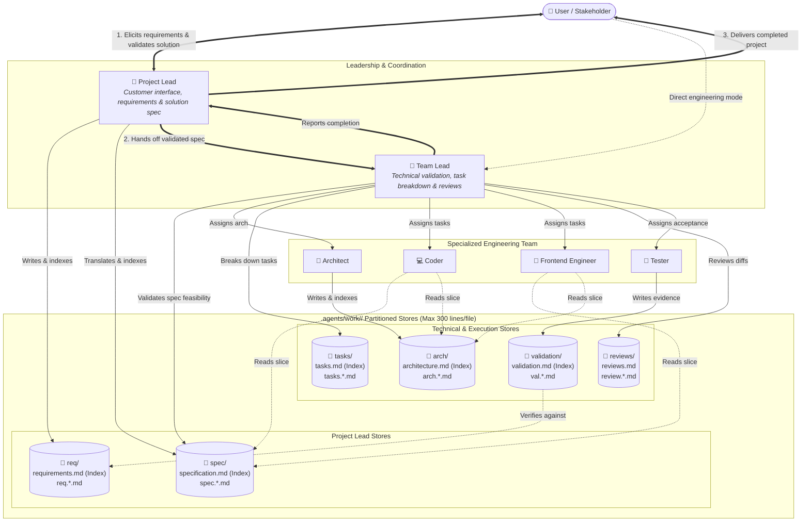

# agent-skills

Repository for storing and sharing reusable custom agents and skills I use periodically.

This repo uses the open [Agent Skills](https://agentskills.io/) format so the skills here stay **AI toolchain agnostic**. The canonical location for skills is `.agents/skills/`. Custom agents live under `.agents/agents/` as markdown files with YAML frontmatter.

## Repository intent

- Keep reusable skills in a portable, shareable format.
- Prefer the standard `SKILL.md`-based Agent Skills structure over tool-specific skill formats.
- Keep custom agents next to skills so this repository is the source of truth for both.
- Use this repository as the source of truth for skills and agents that can be consumed by compatible clients.

## Skill layout

Each skill should live under `.agents/skills/<skill-name>/` and follow the standard structure:

```text
.agents/
└── skills/
    └── <skill-name>/
        ├── SKILL.md
        ├── scripts/
        ├── references/
        └── assets/
```

Notes:

- `SKILL.md` is required.
- `scripts/`, `references/`, and `assets/` are optional.
- Keep instructions portable and avoid coupling a skill to one AI product unless that dependency is explicit and necessary.

## Agent layout

Each agent is a single markdown file:

```text
.agents/
└── agents/
    └── <agent-name>.md
```

Notes:

- YAML frontmatter must include `name` and `description`.
- The markdown body is the agent's system prompt.
- Keep the prompt focused on behavior the default agent does not already have.

Grok discovers project agents from `.grok/agents/` and user agents from `~/.grok/agents/`. This repository mirrors catalog agents into `.grok/agents/` so they load in this workspace. To use an agent in other projects, copy it to `~/.grok/agents/`, or start a session with `--agent-profile .agents/agents/<agent-name>.md`.

Each agent can be invoked directly by the user as a standalone session agent for focused tasks (e.g. system design with `architect`, TDD implementation with `coder`, UI/UX presentation with `frontend-engineer`, verification with `tester`, or technical leadership with `team-lead`). For the full autonomous software-team loop, start as `project-lead` (spawns `team-lead` and workers as siblings) or as `team-lead` (spawns workers directly). Subagents cannot nest; the `software-team` skill defines the spawn and escalation rules.

## Development contact model & partitioned storage

When driving project development with the agent team, interaction follows a two-tier contact model paired with a partitioned, index-driven storage structure:

1. **User $\leftrightarrow$ Project Lead (Product & Solution Scope)**:
   - **Project Lead** is the primary contact point for the user. It interviews the user, captures needs under `req/`, translates them into a concrete functional solution specification under `spec/`, and confirms the spec with the user before engineering begins.
   - Shields the user from technical implementation noise while escalating product decisions, edge-case trade-offs, and status.
2. **Project Lead $\to$ Team Lead (Technical Handoff & Spec Validation)**:
   - Once confirmed, Project Lead hands the solution specification to **Team Lead**, who validates feasibility against the codebase before commissioning architecture or tasks.
3. **Team Lead $\leftrightarrow$ Workers (Engineering Execution & Reviews)**:
   - Team Lead directs specialized workers (**Architect**, **Coder**, **Frontend Engineer**, **Tester**) via task assignments under `tasks/` and diff reviews under `reviews/`.
   - Workers report exclusively to Team Lead (and cross-consult Architect on design questions). Tester validates the delivered implementation against `req/` and `spec/` into `validation/`.
4. **Direct / Engineering-only Mode**:
   - The user can bypass Project Lead and drive work directly with **Team Lead** for pure technical initiatives, or invoke any individual agent 1:1 for standalone tasks.

### Contact and storage model diagram



### Partitioned work storage & 300-line ceiling rule

Project state lives under `.agents/work/<slug>/` in the consuming repository. To prevent context degradation and maintain modularity as projects scale:
- **300-Line Ceiling**: No single Markdown file may exceed 300 lines. When an area grows beyond this threshold, it must be split into modular topic files (e.g. `spec.<area>.md` or `arch.<subsystem>.md`).
- **Index-and-Topic Pattern**: Each domain folder contains a root index file (e.g., `req/requirements.md`, `spec/specification.md`, `arch/architecture.md`, `tasks/tasks.md`) that serves as a Table of Contents referencing topic files.
- **Surgical Context Loading**: Agents load only the specific topic files needed for their assigned task rather than ingesting entire monolithic documents.

## Adding agents

When adding a new agent:

1. Create `.agents/agents/<agent-name>.md` with valid frontmatter and a focused prompt body.
2. Mirror the same file to `.grok/agents/<agent-name>.md` so Grok can load it in this workspace.
3. Add a row to the Agents index below.
4. Keep personal runtime data (memories, logs) out of git.

## Agents index

| Agent | Purpose | Notes |
| --- | --- | --- |
| `assistant` | Persistent personal assistant that stores local memories of notable topics and recalls them first. | Uses the `assistant-memory` skill. Memories live under `~/.memory/assistant/` (user) and `<repo>/.memory/assistant/` (workspace). Recall searches and loads at most 4 topic files; cold topics move to `archive/`. Those paths are gitignored. |
| `project-lead` | Collects, clarifies, and stores requirements; authors solution specs; user-facing coordinator in the team loop. Never writes code. | Uses `software-team`. Writes `STATUS.md`, `req/` requirements, and `spec/` solution specifications under `.agents/work/<slug>/`, then hands off to `team-lead`. Can be invoked directly for product and scoping discussions. |
| `team-lead` | Validates specs, reviews architecture and implementation, assigns work. Never writes code, architecture, or tests. | Uses `software-team`. Manages `tasks/` and `reviews/`. Can be invoked directly as session lead (spawns workers, talks to user) or as a child agent under Project Lead (returns `## Next` assignments). |
| `architect` | Extensible, loosely coupled architecture and stack recommendations. | Uses `software-team`. Writes architecture plans and designs under `arch/` (`architecture.md` and `arch.<subsystem>.md`); never production code. Can be invoked directly by the user or as a team worker. |
| `coder` | Implements tasks with TDD and SOLID. | Uses `software-team`. Writes production code and automated tests. Reads `tasks/`, `spec/`, and `arch/`. Can be invoked directly by the user for implementation tasks or assigned tasks from `tasks/`. |
| `frontend-engineer` | Implements UI/UX components, responsive styling, and accessibility. | Uses `software-team`. Writes production HTML, CSS/Tailwind, UI components, and component tests. Reads `tasks/`, `spec/`, and `arch/`. Can be invoked directly by the user or assigned tasks from `tasks/`. |
| `tester` | Validates delivery against requirements and solution specs. | Uses `software-team`. Produces validation reports under `validation/` against `req/` and `spec/`. Can be invoked directly by the user or as a team worker reporting to Team Lead. |

## Adding skills

When adding a new skill:

1. Create a new directory under `.agents/skills/`.
2. Add a `SKILL.md` file with valid Agent Skills frontmatter.
3. Add optional scripts, references, or assets only when the skill needs them.
4. Keep the skill focused, reusable, and vendor-neutral by default.

## Skills index

This section is the running catalog of skills in this repository.

| Skill | Purpose | Notes |
| --- | --- | --- |
| `commit-and-push` | Stages intended changes, creates a commit, and pushes the current branch. | Portable git workflow skill for publishing repository work. |
| `repo-skill-manager` | Lists, installs, and updates skills published from this repository. | Manages project-scoped and global installs under the standard `.agents/skills` layout. |
| `assistant-memory` | Searches, writes, and compacts Assistant's local topic memories. | Ranked search over Markdown topic files so recall stays bounded as the topic count grows. |
| `software-team` | Shared delivery contract for the software-team agents. | Owns work-dir layout, phases, spawn rule, review format, and escalation. Runtime work lives under `.agents/work/<slug>/` in the consuming project. |
